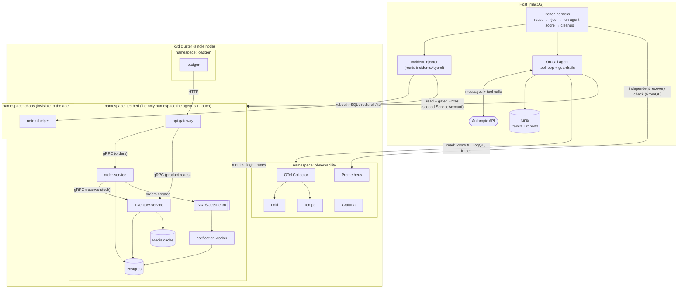

# Architecture

> **Status: Phase 1 built** (testbed, observability, load generator). The
> incident library, agent and harness sections are still design. Each section is
> updated when its phase lands, and anything marked "to verify" is an assumption
> that a later phase must confirm by running it.

## What this is

An AI on-call agent that diagnoses and remediates failures injected into a small
Go microservice system on local Kubernetes, plus a benchmark that measures how
well the agent does across Claude models. Three parts, deliberately separated:

| Part | Language | Role |
|---|---|---|
| **Testbed** | Go | The system under test: 4 services, data stores, telemetry, load. |
| **Incident library** | YAML + Python | Declarative, reversible failures with ground truth. |
| **Agent + harness** | Python | Investigates through tools; the harness scores it. |

The agent only ever sees the testbed through its tools. It never reads the
incident library, and the harness never tells it what was injected.

## Diagram



## Testbed

**Request flow.** `loadgen` sends 10 requests per second to `api-gateway` over
HTTP: 70% product lookups, 20% new orders, 5% order lookups, 5% order lists.

| Route | Path through the system |
|---|---|
| `GET /api/products/{sku}` | gateway → `inventory-service` → Redis cache, falling back to Postgres |
| `POST /api/orders` | gateway → `order-service` → `inventory-service` (reserve stock) → Postgres, then publish `orders.created` to NATS JetStream |
| `GET /api/orders/{id}`, `GET /api/customers/{id}/orders` | gateway → `order-service` → Postgres |

`notification-worker` consumes `orders.created` with a durable pull consumer and
records each notification in Postgres.

This gives one synchronous chain three services deep (for cascading failures and
latency propagation) and one asynchronous branch (for consumer lag), with a
cache and a database that can each fail in their own ways. The gateway reads
products from `inventory-service` directly rather than through `order-service`,
so a fault in one of the two back-end services degrades some routes and not
others, which is what makes the per-route panels worth looking at.

**Stack.** Go 1.26, one module, one image holding all five binaries (each
Deployment picks its binary with `command`): one build, and one image to load
into the cluster. Standard library `net/http` and `log/slog` (JSON logs carrying
`trace_id` and `span_id`), `grpc-go`, `pgx`, `go-redis`, `nats.go`,
`prometheus/client_golang`, and the OpenTelemetry SDK.

**Trace context over NATS.** The trace has to survive the hop through the
message broker for one trace to cover a whole order. OpenTelemetry's stock
header carrier writes `Traceparent`; NATS header names are case-sensitive and
the server rewrites that header to lower-case `traceparent`, so the stock
carrier silently finds nothing on the consuming side. `internal/events` has its
own small carrier and a round-trip test for this.

**Cluster.** k3d (k3s in Docker), single node. Chosen over kind because k3s
idles at a lower memory footprint, and this project has to fit on an 8 GB
laptop. Manifests are plain YAML with kustomize (built into `kubectl`), not
Helm: every line deployed is in the repo and readable.

`make up` writes a kubeconfig containing only this cluster into the repository
directory (gitignored), and every command uses that file. `~/.kube/config` is
never read or written, so nothing here can act on another cluster by mistake.
All published ports are bound to 127.0.0.1.

**Deploy order.** `make deploy` applies Postgres, Redis and NATS first and waits
for them, then applies everything else. The services would get there anyway by
retrying and restarting, but then a freshly created cluster shows a different
restart count on healthy pods each time, and restart counts are evidence the
agent reads.

**Probes.** Readiness turns true once a service has connected to its
dependencies at startup and does not re-check them afterwards: if every replica
went unready whenever Postgres was slow, the service would vanish from its
Service instead of failing requests individually and visibly. Liveness is
deliberately slow: a restart only after a full minute without an answer. It exists to catch a hung
process, not a slow one. This was learned by breaking it: with the default
liveness settings, a 20-second stall of the kubelet itself (the host was short
of memory during a large compile) made every probe time out at once, and every
healthy Go container was restarted in the same second.

**The load generator has its own namespace** (`loadgen`), outside the one the
agent can touch. It is the customer, not part of the system being operated.

**Observability, sized for 8 GB.**

| Signal | Component | Notes |
|---|---|---|
| Metrics | Prometheus, kube-state-metrics, kubelet cAdvisor, exporter sidecars for Postgres, Redis and NATS | Plain Prometheus, 10 s scrape, 12 h retention. No Alertmanager: alert rules will be evaluated by Prometheus and read from its API (rules arrive with the incidents in Phase 2). |
| Logs | Loki (single binary) | Filesystem storage, 24 h retention. |
| Traces | Tempo (single binary) | Local disk, 12 h retention. Chosen over Jaeger because Grafana links traces to logs natively. |
| Collection | One OTel Collector (DaemonSet) | Tails container log files to Loki and receives OTLP traces for Tempo. Metrics do not pass through it. |
| Dashboards | Grafana | Datasources and one dashboard provisioned from files in the repo. The dashboard JSON is generated by `deploy/observability/dashboards/generate.py`, so its queries are reviewable as code. |

**Telemetry is scoped on purpose.** The collector reads only
`/var/log/pods/testbed_*`, kube-state-metrics watches only the `testbed`
namespace, and Prometheus discovers pods only in `testbed`, `loadgen` and
`observability`. Whatever the incident injector does in the `chaos` namespace
cannot show up in a log line or a metric, so the agent cannot find the answer by
reading the injector's telemetry.

**Three things the collector does that were learned by running it:**

- It lower-cases log severity. Go's `slog` writes `ERROR` and Loki's own
  detection on plain-text lines yields `error`; without this, one filter cannot
  cover the namespace.
- It keeps its read positions on the node's disk. A restarted collector
  otherwise re-reads every log file from the top, which was measured to trip its
  memory limiter and then Loki's ingestion limits.
- It caps batch size, because an uncapped backlog went to Loki as requests
  larger than Loki's per-second ingestion limit and was rejected whole.

`make verify` (`scripts/verify_testbed.py`) is the acceptance check for all of
this: it sends real requests through the gateway and then asserts that
Prometheus has every expected scrape target and live traffic, that every query
on the dashboard returns data, that Loki has logs from each service with trace
IDs and from no other namespace, that Tempo holds a single trace spanning all
four services, and that Grafana can reach all three data sources.

**Memory.** Every container has an explicit memory request and limit. There are
no CPU limits: on a single shared node they would only add throttling noise, and
a CPU limit is something an incident can introduce.

Memory in MiB. "Peak" is the highest working set cAdvisor reported for any
replica in the first 76 minutes of a fresh cluster at the default load. The host
was short of memory for most of that time (see "Known limits" below), so read
the peaks as "under stress", not as a quiet-host baseline. Raw data:
[`results/phase1-soak/`](../results/phase1-soak/).

| Container | Replicas | Request | Limit | Peak |
|---|---|---|---|---|
| tempo | 1 | 96 | 384 | 371 |
| grafana | 1 | 96 | 256 | 221 |
| loki | 1 | 96 | 256 | 213 |
| otel-collector | 1 | 96 | 200 | 152 |
| postgres | 1 | 192 | 384 | 124 |
| prometheus | 1 | 128 | 384 | 114 |
| order-service | 2 | 32 | 96 | 31 |
| api-gateway | 2 | 32 | 96 | 30 |
| notification-worker | 1 | 32 | 96 | 30 |
| inventory-service | 2 | 32 | 96 | 29 |
| nats | 1 | 32 | 128 | 28 |
| nats-exporter | 1 | 16 | 64 | 22 |
| loadgen | 1 | 24 | 64 | 22 |
| kube-state-metrics | 1 | 24 | 64 | 21 |
| redis-exporter | 1 | 16 | 64 | 18 |
| postgres-exporter | 1 | 24 | 64 | 15 |
| redis | 1 | 32 | 128 | 15 |
| **Total across replicas** | | **1096** | **3112** | |

The whole node, k3s included, peaked at a 2500 MiB working set inside the
4 GB Docker VM.

Go processes (the collector, Tempo, Loki and the testbed services) get a
`GOMEMLIMIT` at roughly 80% of their container limit, so the runtime collects
garbage harder near the ceiling instead of being OOM-killed. It is a soft limit
and not a guarantee, as Tempo shows below.

**Known limits of a laptop-sized testbed.**

- *Warm-up.* For the first minutes after `make up`, while everything starts at
  once, the gateway returns some errors. The harness must wait for a
  steady-state check to pass before injecting anything (Phase 5).
- *Host memory.* A 4 GB VM on an 8 GB Mac leaves little for anything else. With
  a browser and an editor open, macOS swapped the VM's memory in and out
  continuously, and the testbed slowed down as a whole: every container's CPU
  use rose several-fold at the same moments, including idle ones. In two
  25-minute runs with no fault injected, the gateway returned 504 for 1.5% and
  6.5% of requests, with a median p99 of 1.5 s and 2.5 s. In a quiet stretch of
  the first run the p99 was 25 to 56 ms with no errors, which is what the
  testbed does when the host lets it. **A benchmark run is only meaningful on a
  quiet host.**
- *Host stalls restart containers.* During a large compile on the Mac the
  kubelet missed its own lease renewals and healthy containers were restarted.
  Liveness probes are now tolerant of this: no testbed container restarted in
  either run above. *To do in Phase 5:* the harness records restart counts,
  scrape gaps and baseline error rate around each incident and discards, rather
  than scores, a run where the platform itself misbehaved.
- *Tempo is the tightest fit.* It stores very little data at this load, but
  writing and compacting its Parquet blocks allocates memory in bursts: those
  two code paths made 72% of all allocations in a heap profile of the first
  run, and the live heap was 172 MiB at one profile and 71 MiB at another. Its
  working set peaked at 356 MiB of 384 in the first run. In the second it
  restarted twice, at least once OOM-killed. A smaller Parquet row group
  (`parquet_row_group_size_bytes`) was tried in that second run and reverted:
  it did not lower the peak. *Open:* re-measure on a quiet host before deciding
  between a higher limit and a different setting.
- *OOM kills do not show in cAdvisor's counter.* `container_oom_events_total`
  stayed at zero although Tempo was OOM-killed. *To verify in Phase 2:* detect
  OOM kills in `testbed` from kube-state-metrics' last-terminated reason
  instead.

## Incident library

Each incident is one YAML file: `id`, `description`, `inject` steps, `cleanup`
steps, `ground_truth` (one or more causes, each a component plus a fault
category), `affected_services`, `detection` (the alert expected to fire), and
`acceptable_remediations`.

Design rules:

1. **Inject from outside where possible.** Dropping a Postgres index, shrinking
   Redis `maxmemory`, changing a resource limit, or pushing a bad config value
   are real operations, not test hooks. A few faults (a memory leak) need a code
   path in a service, enabled by config.
2. **No tell-tale names.** No env var, label, annotation, log line, or metric
   may name the fault. `FAULT_LEAK=true` would turn diagnosis into string
   matching. Config that enables a buggy path looks like an ordinary setting.
3. **Config changes are real rollouts.** Service config lives in the Deployment
   spec, so a bad config push creates a new ReplicaSet revision. That makes
   "recent deploy history" and "rollback" the genuine Kubernetes operations.
   Faults injected elsewhere (database, Redis, network) leave no entry in
   deploy history, which is also realistic.
4. **Cleanup is verified, not assumed.** After cleanup the harness checks the
   same health conditions it uses for recovery scoring. An incident that does
   not return the cluster to healthy is a bug in the incident.

Network faults use `tc netem` applied to a pod's network namespace by a helper
in the `chaos` namespace. *To verify in Phase 2:* that Docker Desktop's Linux
kernel ships the `sch_netem` module. Fallback is a proxy-based injector.

## Agent

**Loop.** A hand-written tool-use loop over the Anthropic Messages API (official
Python SDK). Hand-written rather than the SDK's tool runner because the loop is
where caps, tracing, and the write gate live, and those need to be code I can
point at and test. The conversation history is append-only.

**Trigger.** The agent starts from an alert payload containing only a symptom
(for example "5xx rate on api-gateway above 5% for 2 minutes"), the way a human
on-call would.

**Tools take typed parameters, never commands.** The model cannot pass a shell
string or a raw `kubectl` line. Each tool has a JSON schema with enumerated
verbs and resource kinds; code builds the argument list and runs it without a
shell.

| Read-only | Write (gated) |
|---|---|
| `query_metrics` (PromQL) | `rollback_deployment` |
| `search_logs` (LogQL) | `scale_deployment` |
| `get_trace` / `search_traces` | `restart_pod` |
| `kube_get`, `kube_describe`, `kube_events` | `revert_config` |
| `deploy_history` | |

Tool output is bounded. When a result is cut, the agent is told how much was
omitted so it can narrow the query; nothing is dropped silently.

**Guardrails are enforced twice.**

*In code*, every write request passes through one function, in this order. Any
step can reject, and every rejection is recorded and counted in the benchmark:

1. Schema validation of the parameters.
2. Scope: namespace must be `testbed`; the target must be a known resource.
3. Allow-list: the action and its parameter values must be explicitly permitted.
4. Budget: write-action cap, tool-call cap, wall-clock cap.
5. Policy mode:
   - `observe` rejects all writes.
   - `propose` records the action and its diff for a human to approve.
   - `auto` executes only actions classified low-risk; the rest become proposals.
6. Server-side dry run and diff, saved to the trace before anything executes.
7. Execute, then re-read the resource to confirm the change applied.

*In Kubernetes*, the agent uses its own ServiceAccount. Its Role exists only in
`testbed`, grants read verbs plus the few write verbs the tools need, and
excludes Secrets. `observe` mode uses a read-only identity. If the code gate had
a bug, the API server would still refuse.

**Output.** The agent finishes by calling a `submit_report` tool whose strict
schema is the incident report: timeline, evidence, root-cause hypothesis
(component, fault category, free-text explanation, confidence), actions taken or
proposed, and recovery verification. Every evidence item must cite the ID of a
tool call from the run; code rejects citations to calls that never happened. The
report is written as JSON and rendered to Markdown.

**Trace.** Every model request, response, tool call, tool result, and guardrail
decision is appended to a JSONL file under `runs/`. The API key is never written
there or to logs. A recorded trace can be replayed through the loop without
calling the API, which is how the loop is unit-tested and how CI runs with no
key.

## Evaluation harness

For each incident: reset to healthy → inject → wait for the alert → run the
agent → score → cleanup → verify healthy.

| Metric | Source |
|---|---|
| Root-cause accuracy | Deterministic comparison of the report's structured cause(s) to ground truth. |
| Time to diagnosis | Wall clock from agent start to `submit_report`. |
| Tool calls, rejected actions | Counted from the trace. |
| Recovery success | Measured by the harness from Prometheus, independent of what the agent claims. |
| Tokens and cost | Token counts as reported by the API, multiplied by a checked-in price table that records its source and retrieval date. |

**Rubric (finalised in Phase 2, documented in `docs/RUBRIC.md`).** Scoring is by
code, not by a model, so the same report always gets the same score. Ground
truth is a set of causes; the report gives a set of causes; credit is awarded
for matching component and matching fault category, with set-based precision and
recall for multi-cause incidents. The fault taxonomy is fixed and larger than
the set of faults actually used, so the list of categories is not an answer key.

**Router.** A cheap model triages first and either submits a report or
escalates, with its findings, to Fable. Benchmarked as its own configuration
against every single-model run.

**Budget.** Total API spend for the project is capped at $50. Consequences:
development uses Haiku and replayed traces; the harness has a hard `--max-cost`
abort; per-incident cost is measured on a few incidents before any full run and
the projection is reviewed first; expensive models may run a fixed, documented
subset chosen before seeing results. One trial per incident means no variance
estimate, and the report will say so.

## Repository layout

```
.
├── Makefile                 # up, down, verify, test, lint; later inject, bench
├── CLAUDE.md                # conventions for AI-assisted work on this repo
├── .env.example
├── pyproject.toml           # Python tool config; the package itself comes in Phase 2
├── docs/                    # ARCHITECTURE.md, later RUBRIC.md, GUARDRAILS.md
├── scripts/                 # verify_testbed.py: the Phase 1 acceptance check
├── testbed/                 # Go module
│   ├── cmd/                 # api-gateway, order-service, inventory-service,
│   │                        # notification-worker, loadgen
│   ├── internal/            # shared: config, telemetry, ops (health, metrics),
│   │                        # rpc, store, events, retry
│   ├── proto/               # gRPC definitions; generated code in gen/
│   └── Dockerfile
├── deploy/                  # kustomize manifests
│   ├── cluster/             # k3d cluster config
│   ├── testbed/             # stores/ (Postgres, Redis, NATS), services/
│   ├── loadgen/
│   ├── observability/       # Prometheus, Loki, Tempo, collector, Grafana,
│   │                        # kube-state-metrics; config/ and dashboards/
│   ├── rbac/                # (Phase 3) agent ServiceAccounts and Roles
│   └── chaos/               # (Phase 2) netem helper
├── incidents/               # one YAML per incident + JSON schema
├── src/oncall/              # Python package
│   ├── agent/               # loop, llm client, tools/, guardrails/, report, trace
│   ├── chaos/               # incident parsing, inject, cleanup
│   └── bench/               # harness, scoring, report generation, router
├── tests/                   # pytest: guardrails, scoring, incident parsing, replay
├── results/                 # committed outputs of real benchmark runs
└── runs/                    # gitignored: full traces
```

## Language choices

**Go for the testbed** because the services are the kind of system Go is used
for, and the failure modes (connection pools, goroutine and memory behaviour,
gRPC deadlines) are real ones.

**Python for the agent and harness** because the Anthropic Python SDK is the
most complete, prompt and tool iteration is fastest there, and scoring reports
with tables and charts are a few lines with pandas and matplotlib. The cost is
two toolchains in one repo. Guardrails being in Python does not make them
softer: they are ordinary functions with unit tests, backed by Kubernetes RBAC.

## Open items (decided in the phase noted)

- Risk classification of each write action for `auto` mode (Phase 4).
- Which policy mode the benchmark uses for recovery scoring, and whether
  `propose` mode is benchmarked with a scripted approver (Phase 5).
- Which incidents form the fixed subset for expensive models, if the budget
  requires one (Phase 5, before any results exist).
