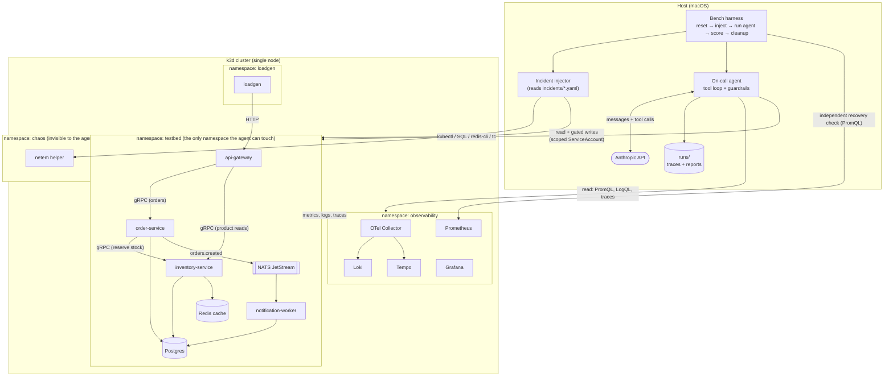

# Architecture

> **Status: Phases 1 to 4 built** (testbed, observability, load generator; the
> first 8 incidents with inject and cleanup; the agent with read-only tools,
> and its write tools behind a guardrail gate in `propose` and `auto` mode).
> The evaluation harness is still design.
> Each section is updated when its phase lands, and anything marked "to verify"
> is an assumption that a later phase must confirm by running it.

## What this is

An AI on-call agent that diagnoses and remediates failures injected into a small
Go microservice system on local Kubernetes, plus a benchmark that measures how
well the agent does across Claude models. Three parts, deliberately separated:

| Part | Language | Role |
|---|---|---|
| **Testbed** | Go | The system under test: 4 services, data stores, telemetry, load. |
| **Incident library** | YAML + Python | Declarative, reversible failures with ground truth. |
| **Agent + harness** | Python | Investigates through tools; the harness scores it. |

The agent only ever sees the testbed through its tools. It never reads the
incident library, and the harness never tells it what was injected.

## Diagram



## Testbed

**Request flow.** `loadgen` sends 10 requests per second to `api-gateway` over
HTTP: 70% product lookups, 20% new orders, 5% order lookups, 5% order lists.

| Route | Path through the system |
|---|---|
| `GET /api/products/{sku}` | gateway → `inventory-service` → Redis cache, falling back to Postgres |
| `POST /api/orders` | gateway → `order-service` → `inventory-service` (reserve stock) → Postgres, then publish `orders.created` to NATS JetStream |
| `GET /api/orders/{id}`, `GET /api/customers/{id}/orders` | gateway → `order-service` → Postgres |

`notification-worker` consumes `orders.created` with a durable pull consumer and
records each notification in Postgres.

This gives one synchronous chain three services deep (for cascading failures and
latency propagation) and one asynchronous branch (for consumer lag), with a
cache and a database that can each fail in their own ways. The gateway reads
products from `inventory-service` directly rather than through `order-service`,
so a fault in one of the two back-end services degrades some routes and not
others, which is what makes the per-route panels worth looking at.

**Stack.** Go 1.26, one module, one image holding all five binaries (each
Deployment picks its binary with `command`): one build, and one image to load
into the cluster. Standard library `net/http` and `log/slog` (JSON logs carrying
`trace_id` and `span_id`), `grpc-go`, `pgx`, `go-redis`, `nats.go`,
`prometheus/client_golang`, and the OpenTelemetry SDK.

**Trace context over NATS.** The trace has to survive the hop through the
message broker for one trace to cover a whole order. OpenTelemetry's stock
header carrier writes `Traceparent`; NATS header names are case-sensitive and
the server rewrites that header to lower-case `traceparent`, so the stock
carrier silently finds nothing on the consuming side. `internal/events` has its
own small carrier and a round-trip test for this.

**Cluster.** k3d (k3s in Docker), single node. Chosen over kind because k3s
idles at a lower memory footprint, and this project has to fit on an 8 GB
laptop. Manifests are plain YAML with kustomize (built into `kubectl`), not
Helm: every line deployed is in the repo and readable.

`make up` writes a kubeconfig containing only this cluster into the repository
directory (gitignored), and every command uses that file. `~/.kube/config` is
never read or written, so nothing here can act on another cluster by mistake.
All published ports are bound to 127.0.0.1.

**Deploy order.** `make deploy` applies Postgres, Redis and NATS first and waits
for them, then applies everything else. The services would get there anyway by
retrying and restarting, but then a freshly created cluster shows a different
restart count on healthy pods each time, and restart counts are evidence the
agent reads.

**Probes.** Readiness turns true once a service has connected to its
dependencies at startup and does not re-check them afterwards: if every replica
went unready whenever Postgres was slow, the service would vanish from its
Service instead of failing requests individually and visibly. Liveness is
deliberately slow: a restart only after a full minute without an answer. It exists to catch a hung
process, not a slow one. This was learned by breaking it: with the default
liveness settings, a 20-second stall of the kubelet itself (the host was short
of memory during a large compile) made every probe time out at once, and every
healthy Go container was restarted in the same second.

**The load generator has its own namespace** (`loadgen`), outside the one the
agent can touch. It is the customer, not part of the system being operated.

**Observability, sized for 8 GB.**

| Signal | Component | Notes |
|---|---|---|
| Metrics | Prometheus, kube-state-metrics, kubelet cAdvisor, exporter sidecars for Postgres, Redis and NATS | Plain Prometheus, 10 s scrape, 12 h retention. No Alertmanager: Prometheus evaluates the alert rules in `deploy/observability/config/alerts.yml` every 10 s and the harness reads their state from its API. |
| Logs | Loki (single binary) | Filesystem storage, 24 h retention. |
| Traces | Tempo (single binary) | Local disk, 12 h retention. Chosen over Jaeger because Grafana links traces to logs natively. |
| Collection | One OTel Collector (DaemonSet) | Tails container log files to Loki and receives OTLP traces for Tempo. Metrics do not pass through it. |
| Dashboards | Grafana | Datasources and one dashboard provisioned from files in the repo. The dashboard JSON is generated by `deploy/observability/dashboards/generate.py`, so its queries are reviewable as code. |

**Telemetry is scoped on purpose.** The collector reads only
`/var/log/pods/testbed_*`, kube-state-metrics watches only the `testbed`
namespace, and Prometheus discovers pods only in `testbed`, `loadgen` and
`observability`. Whatever the incident injector does in the `chaos` namespace
cannot show up in a log line or a metric, so the agent cannot find the answer by
reading the injector's telemetry.

**Three things the collector does that were learned by running it:**

- It lower-cases log severity. Go's `slog` writes `ERROR` and Loki's own
  detection on plain-text lines yields `error`; without this, one filter cannot
  cover the namespace.
- It keeps its read positions on the node's disk. A restarted collector
  otherwise re-reads every log file from the top, which was measured to trip its
  memory limiter and then Loki's ingestion limits.
- It caps batch size, because an uncapped backlog went to Loki as requests
  larger than Loki's per-second ingestion limit and was rejected whole.

`make verify` (`scripts/verify_testbed.py`) is the acceptance check for all of
this: it sends real requests through the gateway and then asserts that
Prometheus has every expected scrape target and live traffic, that every query
on the dashboard returns data, that Loki has logs from each service with trace
IDs and from no other namespace, that Tempo holds a single trace spanning all
four services, and that Grafana can reach all three data sources.

**Memory.** Every container has an explicit memory request and limit. There are
no CPU limits: on a single shared node they would only add throttling noise, and
a CPU limit is something an incident can introduce.

Memory in MiB. "Peak" is the highest working set cAdvisor reported for any
replica in the first 76 minutes of a fresh cluster at the default load. The host
was short of memory for most of that time (see "Known limits" below), so read
the peaks as "under stress", not as a quiet-host baseline. Raw data:
[`results/phase1-soak/`](../results/phase1-soak/).

| Container | Replicas | Request | Limit | Peak |
|---|---|---|---|---|
| tempo | 1 | 96 | 384 | 371 |
| grafana | 1 | 96 | 256 | 221 |
| loki | 1 | 96 | 256 | 213 |
| otel-collector | 1 | 96 | 200 | 152 |
| postgres | 1 | 192 | 384 | 124 |
| prometheus | 1 | 128 | 384 | 114 |
| order-service | 2 | 32 | 96 | 31 |
| api-gateway | 2 | 32 | 96 | 30 |
| notification-worker | 1 | 32 | 96 | 30 |
| inventory-service | 2 | 32 | 96 | 29 |
| nats | 1 | 32 | 128 | 28 |
| nats-exporter | 1 | 16 | 64 | 22 |
| loadgen | 1 | 24 | 64 | 22 |
| kube-state-metrics | 1 | 24 | 64 | 21 |
| redis-exporter | 1 | 16 | 64 | 18 |
| postgres-exporter | 1 | 24 | 64 | 15 |
| redis | 1 | 32 | 128 | 15 |
| netem-helper (namespace `chaos`) | 1 | 8 | 32 | added in Phase 2, after this measurement |
| **Total across replicas** | | **1104** | **3144** | |

The whole node, k3s included, peaked at a 2500 MiB working set inside the
4 GB Docker VM.

Go processes (the collector, Tempo, Loki and the testbed services) get a
`GOMEMLIMIT` at roughly 80% of their container limit, so the runtime collects
garbage harder near the ceiling instead of being OOM-killed. It is a soft limit
and not a guarantee, as Tempo shows below.

**Known limits of a laptop-sized testbed.**

- *Warm-up.* For the first minutes after `make up`, while everything starts at
  once, the gateway returns some errors. The harness must wait for a
  steady-state check to pass before injecting anything (Phase 5).
- *Host memory.* A 4 GB VM on an 8 GB Mac leaves little for anything else. With
  a browser and an editor open, macOS swapped the VM's memory in and out
  continuously, and the testbed slowed down as a whole: every container's CPU
  use rose several-fold at the same moments, including idle ones. In two
  25-minute runs with no fault injected, the gateway returned 504 for 1.5% and
  6.5% of requests, with a median p99 of 1.5 s and 2.5 s. In a quiet stretch of
  the first run the p99 was 25 to 56 ms with no errors, which is what the
  testbed does when the host lets it. **A benchmark run is only meaningful on a
  quiet host.**
- *Host stalls restart containers.* During a large compile on the Mac the
  kubelet missed its own lease renewals and healthy containers were restarted.
  Liveness probes are now tolerant of this: no testbed container restarted in
  either run above. *To do in Phase 5:* the harness records restart counts,
  scrape gaps and baseline error rate around each incident and discards, rather
  than scores, a run where the platform itself misbehaved.
- *An overload outlasts its trigger.* Seen in Phase 3
  ([data](../results/phase3-agent/cluster-health.json)): with no incident
  injected, the cluster was healthy at 18:30 UTC, became overloaded at about
  18:48 while a dependency install and a lint run were using the Mac's memory,
  and stayed that way for about 50 minutes after those had finished: gateway
  p95 between 0.8 and 3.9 s, 1% to 48% errors, 4 to 13 alerts firing, and at
  one point an API server that did not answer. The load generator was paused
  from 19:24 to 19:28; the overload came back for eight minutes when traffic
  returned and cleared at 19:38. Whether the pause helped is not established.
  It returned at 20:11 after a burst of commands on the host, with nothing
  injected, and cleared by itself at 20:22. The agent runs in
  `results/phase3-agent/` were made in the healthy window in between, each
  after `make healthy` passed. It happened again in Phase 4
  ([data](../results/phase4-guardrails/cluster-health.json)): 04:49 to 05:06
  UTC on 2026-11-16, with nothing injected and 19 GB of swap in use, p95 up
  to 7.5 s and up to 47% errors. *For Phase 5:* the harness must refuse to inject
  into an unhealthy cluster, and a full benchmark needs the browser closed.
- *Tempo is the tightest fit.* It stores very little data at this load, but
  writing and compacting its Parquet blocks allocates memory in bursts: those
  two code paths made 72% of all allocations in a heap profile of the first
  run, and the live heap was 172 MiB at one profile and 71 MiB at another. Its
  working set peaked at 356 MiB of 384 in the first run. In the second it
  restarted twice, at least once OOM-killed. A smaller Parquet row group
  (`parquet_row_group_size_bytes`) was tried in that second run and reverted:
  it did not lower the peak. *Open:* re-measure on a quiet host before deciding
  between a higher limit and a different setting.
- *OOM kills do not show in cAdvisor's counter.* `container_oom_events_total`
  stayed at zero although Tempo was OOM-killed. Verified in Phase 2: it also
  stayed at zero while the inventory service was OOM-killed eight times. The
  signal that works is kube-state-metrics'
  `kube_pod_container_status_last_terminated_reason{reason="OOMKilled"}`,
  together with the restart counter; `kubectl describe pod` shows the same
  thing as `Last State: Terminated, Reason: OOMKilled, Exit Code: 137`
  ([data](../results/phase2-incidents/calibration/memory_limit_probe.json)).

## Incident library

Each incident is one YAML file in `incidents/`, named after its `id`. The
format is defined by pydantic models
([`src/oncall/chaos/incident.py`](../src/oncall/chaos/incident.py)); the JSON
schema generated from them is checked in as `incidents/schema.json`, and a test
fails if the two drift apart.

| Field | Meaning |
|---|---|
| `id`, `title`, `description` | For people. The description says what a user or operator would experience. |
| `scenarios` | Symptom classes from the project brief (crash loop, consumer lag, ...), used only to report coverage. |
| `inject`, `cleanup` | Lists of typed steps, see below. |
| `ground_truth.causes` | One or more (component, fault category) pairs from a closed vocabulary. See [`RUBRIC.md`](RUBRIC.md). |
| `affected_services` | Components whose behaviour degrades. |
| `detection` | The alerts expected to fire (the first is the page the agent starts from), a deadline, and evidence queries. |
| `acceptable_remediations` | Write actions that fix it, or `manual` when none of the agent's tools can. |

Design rules:

1. **Inject from outside where possible.** Dropping a Postgres index, shrinking
   Redis `maxmemory`, changing a resource limit, or pushing a bad config value
   are real operations, not test hooks. A few faults (a memory leak) need a code
   path in a service, enabled by config.
2. **No tell-tale names.** No env var, label, annotation, log line, or metric
   may name the fault. `FAULT_LEAK=true` would turn diagnosis into string
   matching. Config that enables a buggy path looks like an ordinary setting.
   Steps cannot set labels or annotations at all, and the parser rejects
   environment variable names containing words such as `FAULT` or `CHAOS`.
3. **Config changes are real rollouts.** Service config lives in the Deployment
   spec, so a bad config push creates a new ReplicaSet revision. That makes
   "recent deploy history" and "rollback" the genuine Kubernetes operations.
   Faults injected elsewhere (database, Redis, network) leave no entry in
   deploy history, which is also realistic.
4. **Cleanup is verified, not assumed.** See "Proving an incident works" below.
   An incident that does not return the cluster to healthy is a bug in the
   incident.

**Steps are a closed list of typed actions, not shell.** An incident file can
only say things like "set this environment variable on this Deployment"; code
turns that into a `kubectl` argument list and runs it without a shell
([`steps.py`](../src/oncall/chaos/steps.py)). A typo is a validation error
instead of a command that does something else, and reviewing an incident does
not require reading shell.

| Inject step | What it does |
|---|---|
| `set_env` | Change environment variables of a service (a rollout). |
| `set_resources` | Change a service container's CPU or memory requests and limits (a rollout). |
| `scale` | Change a service's replica count. |
| `postgres_sql` | Run one SQL statement with `psql` inside the Postgres pod. |
| `redis_command` | Run one Redis command with `redis-cli` inside the Redis pod. |
| `netem` | Delay or drop packets leaving one or all pods of a service. |

**Cleanup states the end state instead of undoing steps.** The cleanup step for
anything done to a Deployment is `restore_deployment`: replace the live object
with the one rendered from `deploy/`. It is therefore also correct after the
agent has rolled back, scaled or restarted things in between, and harmless to
run twice. Two details:

- It uses `kubectl replace`, not `apply`. Apply merges, so it would restore a
  changed value but leave behind a field that an incident (or the agent)
  added, such as a CPU limit.
- It then deletes the ReplicaSets left at zero replicas. Otherwise the faulty
  revision of one incident would still be in the rollout history during the
  next: a red herring at best and a hint at worst. One revision remains, the
  good one, which is also what a rollback in the next incident returns to.

The other cleanup steps are `clear_netem`, `postgres_sql` and `redis_command`.
The data stores have no `restore_deployment`: their data is on `emptyDir`, and
recreating their pods would wipe it.

**Network faults** use Linux `tc netem` on the `eth0` of a target pod, applied
from outside the pod by a helper in the `chaos` namespace
([`deploy/chaos/`](../deploy/chaos/)). The helper is a pod that sleeps (request
8 MiB, limit 32 MiB) and shares the node's PID namespace; the injector
`kubectl exec`s a small script in it that finds a process of the target pod by
the pod UID in its cgroup path, enters that process's network namespace with
`nsenter`, and runs `tc`. Nothing about the target pod's spec, status or events
changes, which is what makes the fault realistic to diagnose. The helper is the
one privileged workload in the cluster; that is acceptable only because the
cluster is a throwaway on a laptop. Docker Desktop's kernel
(6.10.14-linuxkit) has `sch_netem` built in; the k3s node image has no `tc`
binary, which is why the helper has its own image (Alpine plus `iproute2-tc`).

**Alert rules are symptoms.** The seven rules in `alerts.yml` describe what a
user or operator would notice (error rate, latency, restarts, unavailable
replicas, consumer lag, cache hit ratio, slow statements) and never a cause.
Each threshold is set against a measured healthy baseline, noted next to the
rule. One was wrong at first: `DatabaseQuerySlow` asked for a median above
50 ms, a table scan of `orders` takes 42 to 58 ms here, and the alert never
fired. It is now 25 ms, against a baseline below 10 ms. A threshold may be
moved like this when the testbed's own signal shows it is misplaced; it may not
be moved to make an incident easier or harder for the agent.

**"Healthy" is defined once** ([`health.py`](../src/oncall/chaos/health.py)):
every Deployment in `testbed` has the replica count its manifest asks for, with
all replicas updated and available, and no alert is pending or firing. Because
latency spikes come and go on this machine, a single clean reading is not
enough: the state has to hold for a stretch (60 s before an injection, 30 s
after a cleanup).

### Proving an incident works

`make incident-check INCIDENT=<id>` ([`check.py`](../src/oncall/chaos/check.py))
runs one incident against the live cluster with no agent involved:

1. Wait until the cluster has been healthy for 60 s. If that does not happen
   within 10 minutes, or if one of the incident's evidence queries already
   returns something, record `not_run` and inject nothing.
2. Record the gateway's error share and p99 as the baseline, then inject.
3. Poll until every expected alert is firing and every evidence query has
   returned a result, or the incident's deadline passes.
4. Run the cleanup steps, whatever happened before.
5. Wait until the cluster has been healthy, **and every evidence query has
   returned nothing**, for 30 s in a row.

An evidence query is written like an alert expression: it returns a result only
while the fault is visible. Using the same queries in steps 3 and 5 is what
makes "cleans up fully" a measurement against telemetry instead of an
assumption that the cleanup commands worked. Every value in the resulting JSON
record is read from Prometheus, Loki, the Kubernetes API or the clock during
the run.

The records for the first eight incidents, and an account of the three that
failed a first pass and why, are in
[`results/phase2-incidents/`](../results/phase2-incidents/README.md). Two
things from those runs matter for later phases:

- An incident usually raises more than its "own" alert. A slow inventory
  replica raises latency and error-rate alerts at the gateway and makes
  `stock.get` look like a slow database statement. The agent starts from a
  symptom that several different faults share.
- The check ran each incident once. Phase 5 repeats runs before quoting any
  timing as typical.

## Agent

> **Built in Phase 3:** the loop, the read-only tools, the report, the trace and
> its replay, all in `observe` mode. **Built in Phase 4:** the four write tools,
> the guardrail gate, the write identity, and the `propose` and `auto` modes.

| Module (`src/oncall/agent/`) | What it holds |
|---|---|
| `loop.py` | The tool-use loop, its limits, and every way a run can end |
| `llm.py` | The only code that talks to the Anthropic API |
| `prompt.py`, `page.py` | What the model is told: the system prompt, and the alert that paged it |
| `tools/` | The read-only tools, one file per backend |
| `guardrails/` | The write tools, the policy that limits them, and the gate every write passes through |
| `report.py` | The `submit_report` schema, the checks on a submission, the Markdown rendering |
| `trace.py`, `replay.py` | The JSONL trace, and running the loop again from one |
| `pricing.py` | The price table and the cost of a request |
| `identity.py` | The kubeconfigs of the agent's two cluster identities |
| `runner.py`, `cli.py` | One investigation from page to files; the command line |

**Loop.** A hand-written tool-use loop over the Anthropic Messages API (official
Python SDK). Hand-written rather than the SDK's tool runner because the loop is
where limits and tracing live, and the write gate sits directly behind it; those
need to be code I can point at and test. Each turn sends the whole conversation; the
reply is appended exactly as it arrived (thinking blocks included), the tools it
asked for are run, and their results go back as one user message. Nothing in
the conversation is ever edited, which is what lets the API cache the prefix.
The stop reason is checked before anything in a reply is acted on: tool calls in
a reply that was refused or cut off at the output limit are not run.

**What the model is told.** Two things, and nothing about any incident:

- *The system prompt*: how the testbed is built, where its telemetry is, how to
  investigate, and how to express a root cause. The fault categories and the
  rules for choosing a (component, category) pair are the rubric's own text
  ([`RUBRIC.md`](RUBRIC.md) says they apply "to incident authors and to the agent
  alike"), generated from the same Python table and checked against the document
  by a test. The prompt is the same for every incident and every model, and
  byte-identical between runs so that it is cached.
- *The page* (the first user message): the alerts that are firing in Prometheus
  when the run starts, each with its name, severity, summary, labels, the time
  its condition became true, and the rule's expression. All seven alert rules
  describe symptoms ("p99 above 1 s"), never causes.

**Tools take typed parameters, never commands.** The model cannot pass a shell
string or a raw `kubectl` line. Each tool has a strict JSON schema; the same
pydantic model then validates the values (ranges, name patterns), and code
builds the argument list and runs it without a shell. The namespace is not a
parameter: it is always `testbed`. Resource kinds are a closed list without
Secrets.

| Read-only (every mode) | Write (`propose` and `auto` only, through the gate) |
|---|---|
| `query_metrics` (PromQL, instant or range), `list_metrics` | `rollback_deployment` |
| `search_logs` (LogQL) | `scale_deployment` |
| `search_traces` (TraceQL), `get_trace` | `restart_pod` |
| `kube_get`, `kube_describe`, `kube_events` | `revert_config` |
| `deploy_history` | |

`list_metrics` (metric names matching a pattern) was added to the original list
so the model looks names up instead of guessing them. There is no tool for pod
logs through the Kubernetes API: logs come from Loki, like everything else.

Tool output is bounded (6,000 characters). When a result is cut, the agent is
told how much was omitted so it can narrow the query; nothing is dropped
silently. A tool failure (a PromQL syntax error, an unreachable backend) is
returned to the model as an error result, not raised.

**Limits.** Every run is bounded, and every way a run can end is a named
outcome in the trace and the report.

| Limit | Default | When reached |
|---|---|---|
| Tool calls | 30 | Soft: further tool calls are refused with the reason, and counted; `submit_report` still works |
| Wall clock | 600 s | Soft, as above |
| Conversation size | 90,000 prompt tokens | Soft, as above. Claude Haiku 5.5 costs five times as much per token above 100,000 |
| Model requests | 45 | Hard: the run ends |
| Cost | $0.50 | Hard: the run ends |
| Rejected reports | 3 | Hard: the run ends without a report |
| Replies without a tool call | 2 nudges | Hard: the run ends on the third |

Outcomes: `report`, `report_rejected`, `no_tool_call`, `max_tokens`, `refusal`,
`context_window_exceeded`, `unexpected_stop_reason`, `request_limit`,
`cost_limit`, `model_error`. Only the first produces a report to score; the
benchmark will count the others as failures, not drop them.

**Write actions.** Four, named after the taxonomy's remediation actions so a
recommendation in a report and a tool call use the same word
([`guardrails/actions.py`](../src/oncall/agent/guardrails/actions.py)):

| Tool | What it changes | Allowed on |
|---|---|---|
| `rollback_deployment` | The pod template becomes the previous revision's, as `kubectl rollout undo` does | the four services |
| `revert_config` | Named settings of the container (environment variables with a literal value, CPU and memory requests and limits) go back to the previous revision's values; everything else the last rollout changed stays | the four services |
| `scale_deployment` | The replica count, 1 to 3 | the four services |
| `restart_pod` | One pod is deleted; its Deployment replaces it | the four services and Redis |

The stores are protected because of what they hold, not because of any
incident. Postgres and NATS keep their data on `emptyDir`, so a new pod starts
with an empty database or stream; none of the stores is built to run two
replicas. Redis may be restarted because it is a cache. Three is the replica
ceiling because each service replica has a 96 MiB limit and the cluster has to
fit in 4 GB. Every name and number is in one file,
[`guardrails/policy.py`](../src/oncall/agent/guardrails/policy.py).

Each action is a *planner*: from typed parameters and a read of the cluster it
works out the exact change, a JSON patch replacing one field of one
Deployment, or the deletion of one pod. A planner is given a read-only view
of the cluster and nothing that can write (a test checks this). Doing
rollbacks as an explicit patch, not `kubectl rollout undo`, is what lets the
gate dry-run it, show its diff, and pin it to the version that was checked:
the patch starts with a JSON-patch `test` of the Deployment's
`metadata.generation`, so a Deployment that someone else changed while a
proposal waited for approval makes the patch fail instead of being
overwritten.

**Guardrails are enforced twice.**

*In code*, every write goes through one function,
[`WriteGate.submit`](../src/oncall/agent/guardrails/gate.py), in this order.
The first check that fails rejects the write; nothing in the cluster is
touched by a rejected write, not even a dry run.

| Step | Rejects when |
|---|---|
| 1. schema | the parameters have the wrong types or an unknown field |
| 2. scope | the name is not a valid object name, or no such Deployment or pod exists in `testbed`, or the pod has no Deployment that would replace it |
| 3. allow-list | the action may not touch that target, a value is out of range, there is no earlier revision, a setting did not change in the last rollout or is a Secret reference, or the change would do nothing |
| 4. budget | 3 writes have reached a dry run in this run; a change to this Deployment was already executed in this run; the same proposal was already made |
| 5. policy | the mode is `observe` |
| 6. dry run | the API server refuses the change (RBAC or admission), or it would change nothing. The diff is written to the trace before step 7 |
| 7. decision | `auto` and low risk: execute. Otherwise ask the approver; with no approver the write stays a proposal |
| 8. execute | then read the object back as the observer and confirm the field has the value the dry run predicted |

The tool-call and time budgets are the loop's: once they are used up, every
tool call is refused before it reaches the gate. One executed change per
Deployment per run exists because a second rollback would flip a Deployment
back to the revision the first one left, and because the effect of a change
should be seen before the next one.

Every write tool call, whatever happened to it, produces an `ActionRecord`
(decision, failed step, reason, risk, diff, kubectl arguments, who approved,
whether it verified). The loop records it with the tool call in the trace,
and it goes into `report.json` and `report.md` with counts per decision. A
rejected write is never dropped.

*Policy modes.*

- `observe`: the agent gets no write tools at all, and its prompt and tools
  are byte-identical to Phase 3's (a test compares them with a Phase 3
  trace). The gate would reject a write anyway, and in this mode no identity
  that can write is even created.
- `propose`: every write that passes is dry-run and recorded as a proposal.
  With `--approve`, the person at the terminal is shown the summary, risk,
  the agent's reason and the diff, and answers y/N; without it, nothing is
  executed. The agent's time budget keeps running while it waits.
- `auto`: low-risk writes are executed without asking; everything else is
  treated as in `propose`.

*Risk*, decided in code from the plan
([`policy.py`](../src/oncall/agent/guardrails/policy.py)). Low risk means the
change keeps every replica's code and configuration, does not reduce the
capacity that is left, and Kubernetes absorbs it on its own. Only that runs
unattended.

| Change | Risk |
|---|---|
| Scale up | low |
| Restart a pod while another replica of its Deployment is available | low |
| Rollback, config revert | medium: every pod is replaced, which helps only if the diagnosis is right |
| Scale down | high: removes capacity during an incident |
| Restart the last available replica (Redis, the notification worker) | high: the component is down until its replacement is ready |

A consequence worth knowing for Phase 5: in `auto` mode, the fixes for most
incidents in the library (a rollback or a config revert) are proposals, not
executions. That follows from the classification, which was made from the
nature of each change and not from the incidents.

*In Kubernetes*, the agent uses its own ServiceAccounts, never the
administrator's kubeconfig. If the code had a bug, the API server would still
refuse. RBAC objects and admission policies cost no memory.

- `oncall-agent-observer` ([`deploy/rbac/`](../deploy/rbac/agent-observer.yaml)).
  Its Role exists only in `testbed` and grants `get` and `list` on pods,
  services, endpoints, endpoint slices, configmaps, events, deployments and
  replicasets. No write verb, no Secrets, no `pods/log`, no `pods/exec`, no
  `watch`, no other namespace, nothing cluster-scoped. Every read tool, and
  every read the gate makes, runs as this account.
- `oncall-agent-operator` ([`agent-operator.yaml`](../deploy/rbac/agent-operator.yaml)),
  created only in `propose` and `auto` mode and given only to the gate. Its
  Role allows `patch` (and `get`, which `kubectl patch` needs; found by running
  it) on the four service Deployments by name, and `delete` on pods. RBAC
  cannot name pods, whose names are generated, so a `ValidatingAdmissionPolicy`
  (CEL, evaluated by the API server itself) narrows that to pods of the
  allowed Deployments, and bounds every Deployment the account touches to 1 to
  3 replicas. It applies to dry runs too, so a proposal the server would
  refuse is never put to a human.
- Before each run the CLI mints one-hour tokens for the accounts it needs
  (`kubectl create token`, with the admin kubeconfig) and writes
  `agent-observer.kubeconfig` and `agent-operator.kubeconfig` with mode 0600.
  Both tokens are given to the trace writer as values it must refuse to write.
  A test keeps the Role and the admission policy in step with `policy.py`.

Checked against the live API server in Phase 4
([`results/phase4-guardrails/`](../results/phase4-guardrails/README.md)): every
write sent straight to the API server with the operator's identity, bypassing
the gate, was refused when it should be: patching Postgres (RBAC), deleting a
pod in another namespace (RBAC), deleting the Postgres pod (admission),
scaling to 0 or 4 (admission).

**Output.** The agent finishes by calling `submit_report`, whose strict schema is
the report: summary, root causes (component, fault category, explanation,
confidence), evidence, timeline, and recommended actions. Component and category
come from the same closed lists as the benchmark's ground truth, so scoring
needs no reading of free text. Code then applies what a schema cannot express:

- Every tool result starts with a call ID (`[call c7 | 7 of 30 tool calls
  used]`), and every evidence item must cite one. A citation of an ID that is
  not at the top of a result the model has received is rejected. That includes
  a call made in the same reply as the report: its ID can be guessed, its
  result has not been read.
- A root cause needs at least one piece of evidence, and may be listed once.
- An empty list of causes is accepted: an agent that found nothing can say so
  (and will score as a miss) instead of being forced to guess.
- No text field may contain `<parameter name=`, the start of a parameter in
  the model's own tool-call syntax. This rule exists because of the first live
  run: the model wrote its whole root-cause list into the `summary` text and
  left the `root_causes` field empty. The call fitted the strict schema, so a
  correct diagnosis was filed as "no root cause"
  ([`results/phase3-agent/`](../results/phase3-agent/README.md)). A strict
  schema guarantees the shape of a call, not that each answer is in its field.

A rejected report is returned to the model with the reasons, recorded, and
counted. The report is written as `report.json` (the page, the submission, the
cited calls with their parameters, and run statistics filled in by code) and
rendered to `report.md` from that file alone.

What the code does not check: that a finding follows from the call it cites.
A citation proves the call was made and its result was shown to the model,
nothing more.

**Trace.** `trace.jsonl`, one JSON object per line, flushed as it is written.
It holds the system prompt and tool definitions (once), every model response
exactly as the API returned it, every tool call with its parameters, result and
duration, every refusal, nudge and rejected report, and how the run ended. Each
request record carries a SHA-256 of the conversation that was sent. The API key
and the cluster token are never passed to the trace; as a tripwire, the writer
is told both values and refuses to write a line that contains either.

**Replay.** `make agent-replay TRACE=<file>` runs the same loop code against a
trace: the recorded responses stand in for the model, the recorded results for
the tools, the recorded readings for the clock. The replay rebuilds the
conversation turn by turn and compares its hash with the recorded one, so a
change in the loop's behaviour is detected, not assumed away. This is how the
loop is tested against a real model's behaviour with no API key (the unit tests
replay the traces in `results/phase3-agent/`), and how anyone can re-derive a
committed report from its trace.

**Cost.** Computed per request from the usage the API reports and a checked-in
price table ([`pricing.py`](../src/oncall/agent/pricing.py)) that records its
source URL and retrieval date. A model with no entry cannot be run. Requests use
prompt caching: one breakpoint after the system prompt (tools and prompt never
change), one moving breakpoint at the end of the conversation.

**Confirmed by the first live runs** (`claude-haiku-5-5`, 2026-11-10; traces in
[`results/phase3-agent/`](../results/phase3-agent/README.md)):

- The API accepts the request as built: strict tool schemas, adaptive thinking
  with a summarised display, `output_config.effort`, no `tool_choice`, no
  sampling parameters, and response content passed back unchanged.
- Caching works as designed. Tools and system prompt are about 6,000 tokens,
  written once and read on every later request, including the first request of
  a run that starts within five minutes of another. Uncached input was 2 to 4
  tokens per request.
- Measured cost: $0.0039 to $0.0072 per investigation (7 to 15 tool calls, 18
  to 37 seconds). Four runs is not a basis for a benchmark projection; Phase 5
  measures per-incident cost again before any full run.
- Not yet exercised by a live model: a rejected report, a refused tool call,
  the nudge, and every outcome other than `report`. Those paths are covered by
  unit tests with scripted replies only.

**Confirmed by the Phase 4 runs** (`claude-haiku-5-5`, 2026-11-16; traces in
[`results/phase4-guardrails/`](../results/phase4-guardrails/README.md)):

- The API accepts the write tools' strict schemas, and the model uses them as
  intended: one proposal in propose mode (a one-variable revert rather than a
  whole rollback), one low-risk scale-up executed by auto mode and then
  watched for its effect, one high-risk Redis restart held back as a
  proposal, and one run that found nothing and wrote nothing.
- Measured cost with write tools: $0.0045 to $0.0161 per investigation (8 to
  30 tool calls, 39 to 72 seconds). A run's first request, which writes the
  tools, the system prompt and the page to the cache, wrote 7,596 to 7,846
  tokens, against 6,306 to 6,331 in the observe-mode runs: the write tools
  and their part of the prompt add roughly 1,300 to 1,500 tokens.
- Not yet exercised by a live model: a write rejected by the gate, a human
  approval or decline, and a failed or unverified write. They are covered by
  unit tests and, for rejections, by a live run of the gate with no model.

## Evaluation harness

For each incident: reset to healthy → inject → wait for the alert → run the
agent → score → cleanup → verify healthy.

| Metric | Source |
|---|---|
| Root-cause accuracy | Deterministic comparison of the report's structured cause(s) to ground truth. |
| Time to diagnosis | Wall clock from agent start to `submit_report`. |
| Tool calls, rejected actions | Counted from the trace. |
| Recovery success | Measured by the harness from Prometheus, independent of what the agent claims. |
| Tokens and cost | Token counts as reported by the API, multiplied by a checked-in price table that records its source and retrieval date. |

**Rubric ([`docs/RUBRIC.md`](RUBRIC.md), fixed in Phase 2 before any agent existed).** Scoring is by
code, not by a model, so the same report always gets the same score. Ground
truth is a set of causes; the report gives a set of causes; credit is awarded
for matching component and matching fault category, with set-based precision and
recall for multi-cause incidents. The fault taxonomy is fixed and larger than
the set of faults actually used, so the list of categories is not an answer key.

**Router.** A cheap model triages first and either submits a report or
escalates, with its findings, to Fable. Benchmarked as its own configuration
against every single-model run.

**Budget.** Total API spend for the project is capped at $50. Consequences:
development uses Haiku and replayed traces; the harness has a hard `--max-cost`
abort; per-incident cost is measured on a few incidents before any full run and
the projection is reviewed first; expensive models may run a fixed, documented
subset chosen before seeing results. One trial per incident means no variance
estimate, and the report will say so.

## Repository layout

```
.
├── Makefile                 # up, down, verify, test, lint, inject, cleanup,
│                            # incident-check, agent, agent-replay; later bench
├── CLAUDE.md                # conventions for AI-assisted work on this repo
├── .env.example
├── pyproject.toml           # the Python package `oncall` and its tool config
├── docs/                    # ARCHITECTURE.md, RUBRIC.md, later GUARDRAILS.md
├── scripts/                 # verify_testbed.py: the Phase 1 acceptance check
├── testbed/                 # Go module
│   ├── cmd/                 # api-gateway, order-service, inventory-service,
│   │                        # notification-worker, loadgen
│   ├── internal/            # shared: config, telemetry, ops (health, metrics),
│   │                        # rpc, store, events, retry
│   ├── proto/               # gRPC definitions; generated code in gen/
│   └── Dockerfile
├── deploy/                  # kustomize manifests
│   ├── cluster/             # k3d cluster config
│   ├── testbed/             # stores/ (Postgres, Redis, NATS), services/
│   ├── loadgen/
│   ├── observability/       # Prometheus, Loki, Tempo, collector, Grafana,
│   │                        # kube-state-metrics; config/ and dashboards/
│   ├── rbac/                # the agent's two ServiceAccounts: read-only, and
│   │                        # the write identity with its admission policy
│   └── chaos/               # netem helper: manifest, image, script
├── incidents/               # one YAML per incident + JSON schema
├── src/oncall/              # Python package
│   ├── agent/               # loop, llm client, tools/, guardrails/, report,
│   │                        # trace, replay
│   ├── chaos/               # incident parsing, inject, cleanup, health,
│   │                        # incident-check
│   └── bench/               # harness, scoring, report generation, router
├── tests/                   # pytest: guardrails, scoring, incident parsing, replay
├── results/                 # committed outputs of real benchmark runs
└── runs/                    # gitignored: full traces
```

## Language choices

**Go for the testbed** because the services are the kind of system Go is used
for, and the failure modes (connection pools, goroutine and memory behaviour,
gRPC deadlines) are real ones.

**Python for the agent and harness** because the Anthropic Python SDK is the
most complete, prompt and tool iteration is fastest there, and scoring reports
with tables and charts are a few lines with pandas and matplotlib. The cost is
two toolchains in one repo. Guardrails being in Python does not make them
softer: they are ordinary functions with unit tests, backed by Kubernetes RBAC
and an admission policy.

## Open items (decided in the phase noted)

- ~~Risk classification of each write action for `auto` mode (Phase 4).~~
  Decided: see "Risk" under Agent. Only scale-ups and restarts of a
  redundant replica run unattended.
- Which policy mode the benchmark uses for recovery scoring, and whether
  `propose` mode is benchmarked with a scripted approver (Phase 5).
- Which incidents form the fixed subset for expensive models, if the budget
  requires one (Phase 5, before any results exist).
