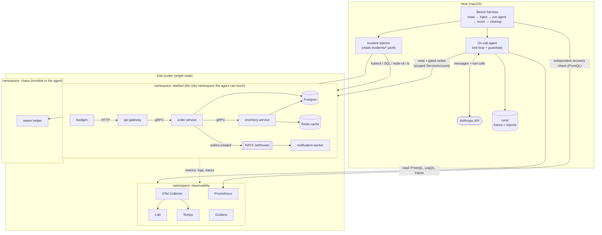

# Architecture

> **Status: Phase 0 design.** Nothing described here is built yet. Each section
> is updated when its phase lands, and anything marked "to verify" is an
> assumption that a later phase must confirm by running it.

## What this is

An AI on-call agent that diagnoses and remediates failures injected into a small
Go microservice system on local Kubernetes, plus a benchmark that measures how
well the agent does across Claude models. Three parts, deliberately separated:

| Part | Language | Role |
|---|---|---|
| **Testbed** | Go | The system under test: 4 services, data stores, telemetry, load. |
| **Incident library** | YAML + Python | Declarative, reversible failures with ground truth. |
| **Agent + harness** | Python | Investigates through tools; the harness scores it. |

The agent only ever sees the testbed through its tools. It never reads the
incident library, and the harness never tells it what was injected.

## Diagram



## Testbed

**Request flow.** `loadgen` sends a steady mix of reads (stock lookups) and
writes (place order) to `api-gateway` over HTTP. The gateway calls
`order-service` over gRPC, which reserves stock from `inventory-service` (gRPC),
writes the order to Postgres, and publishes `orders.created` to NATS JetStream.
`notification-worker` consumes that stream with a durable pull consumer.
`inventory-service` reads through a Redis cache backed by Postgres.

This gives one synchronous chain three services deep (for cascading failures and
latency propagation) and one asynchronous branch (for consumer lag), with a
cache and a database that can each fail in their own ways.

**Stack.** Go 1.24, one module, one Dockerfile. Standard library `net/http` and
`log/slog` (JSON logs carrying `trace_id`), `grpc-go`, `pgx`, `go-redis`,
`nats.go`, `prometheus/client_golang`, and the OpenTelemetry SDK.

**Cluster.** k3d (k3s in Docker), single node. Chosen over kind because k3s
idles at a lower memory footprint, and this project has to fit on an 8 GB
laptop. Manifests are plain YAML with kustomize (built into `kubectl`), not
Helm: every line deployed is in the repo and readable.

**Observability, sized for 8 GB.**

| Signal | Component | Notes |
|---|---|---|
| Metrics | Prometheus + kube-state-metrics | Plain Prometheus, short retention. No Alertmanager: alert rules are evaluated by Prometheus and read from its API. |
| Logs | Loki (single binary) | Filesystem storage. |
| Traces | Tempo (single binary) | Chosen over Jaeger because Grafana links traces to logs natively. |
| Collection | One OTel Collector | Tails pod logs to Loki and receives OTLP traces for Tempo. |
| Dashboards | Grafana | Datasources and dashboards provisioned from files in the repo. |

Every container gets explicit memory requests and limits. Target is roughly
2.5 GB for the whole cluster inside a 4 GB Docker VM. *To verify in Phase 1:*
actual usage, reported from `kubectl top` and `docker stats`.

## Incident library

Each incident is one YAML file: `id`, `description`, `inject` steps, `cleanup`
steps, `ground_truth` (one or more causes, each a component plus a fault
category), `affected_services`, `detection` (the alert expected to fire), and
`acceptable_remediations`.

Design rules:

1. **Inject from outside where possible.** Dropping a Postgres index, shrinking
   Redis `maxmemory`, changing a resource limit, or pushing a bad config value
   are real operations, not test hooks. A few faults (a memory leak) need a code
   path in a service, enabled by config.
2. **No tell-tale names.** No env var, label, annotation, log line, or metric
   may name the fault. `FAULT_LEAK=true` would turn diagnosis into string
   matching. Config that enables a buggy path looks like an ordinary setting.
3. **Config changes are real rollouts.** Service config lives in the Deployment
   spec, so a bad config push creates a new ReplicaSet revision. That makes
   "recent deploy history" and "rollback" the genuine Kubernetes operations.
   Faults injected elsewhere (database, Redis, network) leave no entry in
   deploy history, which is also realistic.
4. **Cleanup is verified, not assumed.** After cleanup the harness checks the
   same health conditions it uses for recovery scoring. An incident that does
   not return the cluster to healthy is a bug in the incident.

Network faults use `tc netem` applied to a pod's network namespace by a helper
in the `chaos` namespace. *To verify in Phase 2:* that Docker Desktop's Linux
kernel ships the `sch_netem` module. Fallback is a proxy-based injector.

## Agent

**Loop.** A hand-written tool-use loop over the Anthropic Messages API (official
Python SDK). Hand-written rather than the SDK's tool runner because the loop is
where caps, tracing, and the write gate live, and those need to be code I can
point at and test. The conversation history is append-only.

**Trigger.** The agent starts from an alert payload containing only a symptom
(for example "5xx rate on api-gateway above 5% for 2 minutes"), the way a human
on-call would.

**Tools take typed parameters, never commands.** The model cannot pass a shell
string or a raw `kubectl` line. Each tool has a JSON schema with enumerated
verbs and resource kinds; code builds the argument list and runs it without a
shell.

| Read-only | Write (gated) |
|---|---|
| `query_metrics` (PromQL) | `rollback_deployment` |
| `search_logs` (LogQL) | `scale_deployment` |
| `get_trace` / `search_traces` | `restart_pod` |
| `kube_get`, `kube_describe`, `kube_events` | `revert_config` |
| `deploy_history` | |

Tool output is bounded. When a result is cut, the agent is told how much was
omitted so it can narrow the query; nothing is dropped silently.

**Guardrails are enforced twice.**

*In code*, every write request passes through one function, in this order. Any
step can reject, and every rejection is recorded and counted in the benchmark:

1. Schema validation of the parameters.
2. Scope: namespace must be `testbed`; the target must be a known resource.
3. Allow-list: the action and its parameter values must be explicitly permitted.
4. Budget: write-action cap, tool-call cap, wall-clock cap.
5. Policy mode:
   - `observe` rejects all writes.
   - `propose` records the action and its diff for a human to approve.
   - `auto` executes only actions classified low-risk; the rest become proposals.
6. Server-side dry run and diff, saved to the trace before anything executes.
7. Execute, then re-read the resource to confirm the change applied.

*In Kubernetes*, the agent uses its own ServiceAccount. Its Role exists only in
`testbed`, grants read verbs plus the few write verbs the tools need, and
excludes Secrets. `observe` mode uses a read-only identity. If the code gate had
a bug, the API server would still refuse.

**Output.** The agent finishes by calling a `submit_report` tool whose strict
schema is the incident report: timeline, evidence, root-cause hypothesis
(component, fault category, free-text explanation, confidence), actions taken or
proposed, and recovery verification. Every evidence item must cite the ID of a
tool call from the run; code rejects citations to calls that never happened. The
report is written as JSON and rendered to Markdown.

**Trace.** Every model request, response, tool call, tool result, and guardrail
decision is appended to a JSONL file under `runs/`. The API key is never written
there or to logs. A recorded trace can be replayed through the loop without
calling the API, which is how the loop is unit-tested and how CI runs with no
key.

## Evaluation harness

For each incident: reset to healthy → inject → wait for the alert → run the
agent → score → cleanup → verify healthy.

| Metric | Source |
|---|---|
| Root-cause accuracy | Deterministic comparison of the report's structured cause(s) to ground truth. |
| Time to diagnosis | Wall clock from agent start to `submit_report`. |
| Tool calls, rejected actions | Counted from the trace. |
| Recovery success | Measured by the harness from Prometheus, independent of what the agent claims. |
| Tokens and cost | Token counts as reported by the API, multiplied by a checked-in price table that records its source and retrieval date. |

**Rubric (finalised in Phase 2, documented in `docs/RUBRIC.md`).** Scoring is by
code, not by a model, so the same report always gets the same score. Ground
truth is a set of causes; the report gives a set of causes; credit is awarded
for matching component and matching fault category, with set-based precision and
recall for multi-cause incidents. The fault taxonomy is fixed and larger than
the set of faults actually used, so the list of categories is not an answer key.

**Router.** A cheap model triages first and either submits a report or
escalates, with its findings, to Fable. Benchmarked as its own configuration
against every single-model run.

**Budget.** Total API spend for the project is capped at $50. Consequences:
development uses Haiku and replayed traces; the harness has a hard `--max-cost`
abort; per-incident cost is measured on a few incidents before any full run and
the projection is reviewed first; expensive models may run a fixed, documented
subset chosen before seeing results. One trial per incident means no variance
estimate, and the report will say so.

## Repository layout

```
.
├── Makefile                 # up, down, test, lint, inject, bench
├── CLAUDE.md                # conventions for AI-assisted work on this repo
├── .env.example
├── docs/                    # ARCHITECTURE.md, later RUBRIC.md, GUARDRAILS.md
├── testbed/                 # Go module
│   ├── cmd/                 # api-gateway, order-service, inventory-service,
│   │                        # notification-worker, loadgen
│   ├── internal/            # shared: telemetry, config, storage
│   ├── proto/
│   └── Dockerfile
├── deploy/                  # kustomize manifests
│   ├── k3d/                 # cluster config
│   ├── testbed/             # services, Postgres, Redis, NATS
│   ├── observability/       # Prometheus, Loki, Tempo, collector, Grafana
│   ├── rbac/                # agent ServiceAccounts and Roles
│   └── chaos/               # netem helper
├── incidents/               # one YAML per incident + JSON schema
├── src/oncall/              # Python package
│   ├── agent/               # loop, llm client, tools/, guardrails/, report, trace
│   ├── chaos/               # incident parsing, inject, cleanup
│   └── bench/               # harness, scoring, report generation, router
├── tests/                   # pytest: guardrails, scoring, incident parsing, replay
├── results/                 # committed outputs of real benchmark runs
└── runs/                    # gitignored: full traces
```

## Language choices

**Go for the testbed** because the services are the kind of system Go is used
for, and the failure modes (connection pools, goroutine and memory behaviour,
gRPC deadlines) are real ones.

**Python for the agent and harness** because the Anthropic Python SDK is the
most complete, prompt and tool iteration is fastest there, and scoring reports
with tables and charts are a few lines with pandas and matplotlib. The cost is
two toolchains in one repo. Guardrails being in Python does not make them
softer: they are ordinary functions with unit tests, backed by Kubernetes RBAC.

## Open items (decided in the phase noted)

- Risk classification of each write action for `auto` mode (Phase 4).
- Which policy mode the benchmark uses for recovery scoring, and whether
  `propose` mode is benchmarked with a scripted approver (Phase 5).
- Which incidents form the fixed subset for expensive models, if the budget
  requires one (Phase 5, before any results exist).
